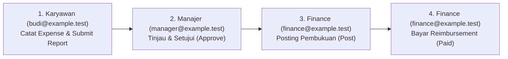

# Panduan Cara Menjalankan Expenses

Dokumen ini berisi panduan lengkap langkah demi langkah untuk mengonfigurasi, menginisialisasi database, dan menjalankan aplikasi **Expenses** di lingkungan lokal.

---

## 1. Prasyarat Sistem (*System Prerequisites*)

Sebelum menjalankan aplikasi, pastikan komputer Anda telah terpasang:

1. **PHP 8.2 atau lebih baru**:
   - Cek versi PHP di terminal: `php -v`
   - Ekstensi PHP yang wajib aktif:
     - `pdo`
     - `pdo_mysql`
     - `fileinfo` (untuk validasi MIME file receipt)
     - `mbstring`
     - `session`
2. **MySQL 8.0 atau lebih baru** (dapat menggunakan MySQL standalone, Laragon, XAMPP, atau Docker):
   - Layanan MySQL harus dalam keadaan berjalan (*running*).
3. **Web Browser Modern** (Chrome, Edge, Firefox, dsb).
4. **Catatan Dependensi**:
   - Aplikasi ini dibangun dengan **PHP 8.2+ Native**, **Bootstrap 5.3**, dan **Chart.js 4.4 UMD**.
   - **Tidak memerlukan Node.js/npm** dan **tidak memerlukan Composer**; seluruh aset frontend vendor telah tersedia secara mandiri (*offline-ready*) di folder `public/assets/vendor/`.

---

## 2. Struktur Konfigurasi Environment (`.env`)

Pastikan file konfigurasi `.env` ada di root folder aplikasi. Jika belum ada, salin dari `.env.example`:

```powershell
Copy-Item .env.example .env
```

Buka dan sesuaikan file `.env` dengan kredensial database Anda:

```ini
APP_ENV=development
APP_DEBUG=true
APP_URL=http://127.0.0.1:8000
APP_TIMEZONE=Asia/Jakarta
SESSION_NAME=expenses_session
DB_HOST=127.0.0.1
DB_PORT=3306
DB_DATABASE=erp_database
DB_USERNAME=root
DB_PASSWORD=
UPLOAD_MAX_BYTES=5242880
STORAGE_PATH=../storage
```

> [!IMPORTANT]
> - Pastikan `DB_DATABASE` bernilai `erp_database` sesuai kontrak skema database.
> - Pastikan `DB_USERNAME` dan `DB_PASSWORD` sesuai dengan akun MySQL Anda.

---

## 3. Inisialisasi Database & Demo Data

Jalankan inisialisasi database dengan urutan yang benar berikut ini:

### Langkah 3.1: Impor Skema Baseline ERP (Hanya 1 Kali)
Jika database `erp_database` belum dibuat atau belum memiliki tabel baseline ERP, buat database dan impor file `database/erp_database.sql`:

**Menggunakan MySQL CLI:**
```powershell
mysql -u root -p -e "CREATE DATABASE IF NOT EXISTS erp_database CHARACTER SET utf8mb4 COLLATE utf8mb4_unicode_ci;"
mysql -u root -p erp_database < database/erp_database.sql
```
*(Atau lakukan import file `database/erp_database.sql` melalui GUI seperti phpMyAdmin atau HeidiSQL).*

> [!WARNING]
> File `database/erp_database.sql` berisi perintah `DROP TABLE` untuk beberapa tabel tertentu. Jalankan file ini **hanya satu kali** pada tahap awal instalasi.

---

### Langkah 3.2: Terapkan Migrasi Integritas Expenses
Jalankan script migration runner untuk menambahkan tabel komentar dan unique constraints:

```powershell
php bin/migrate.php
```

*Output yang diharapkan:*
```text
[OK] Migration 001_gt_expense_integrity.sql berhasil diterapkan.
```

---

### Langkah 3.3: Seed Role & Permission Expenses
Jalankan script untuk memastikan role `EMPLOYEE` dan permissions posting/reimbursement tersedia di database:

```powershell
php bin/seed_roles.php
```

*Output yang diharapkan:*
```text
[OK] Roles & permissions berhasil dipasang/diverifikasi.
```

---

### Langkah 3.4: Seed Data Pengguna & Alur Kerja Demo
Jalankan script seed demo untuk membuat akun pengguna dengan password ter-hash (`password_hash()`), data hierarki karyawan, divisi, master kategori, serta contoh transaksi pengeluaran dan laporan:

```powershell
php bin/seed_demo.php
```

*Output yang diharapkan:*
```text
=== Expenses Demo Data Seeder ===
[OK] Role verifikasi selesai.
...
[OK] Demo Seeding Berhasil Selesai!
```

---

## 4. Memastikan Izin Folder Penyimpanan Bukti (*Storage*)

Aplikasi menyimpan berkas bukti transfer / kuitansi (*receipt*) di luar web root publik (`storage/receipts`) demi keamanan privasi.

Pastikan direktori berikut telah dibuat dan memiliki izin tulis (*write permission*):
- `storage/receipts/`
- `storage/logs/`

*(Folder ini sudah disediakan pada repositori. Jika di Linux/macOS, pastikan `chmod -R 775 storage`).*

---

## 5. Cara Menjalankan Server Web

### Opsi A: Menggunakan PHP Built-in Web Server (Disarankan untuk Pengujian Cepat)

Buka terminal di root direktori proyek (`D:\gt-expense-md-spec`), lalu jalankan:

```powershell
php -S 127.0.0.1:8000 -t public
```

Setelah server aktif, buka peramban (*browser*) Anda dan kunjungi:
👉 **[http://127.0.0.1:8000](http://127.0.0.1:8000)**

> [!NOTE]
> Parameter `-t public` sangat penting karena titik masuk utama (*Document Root*) aplikasi berada pada direktori `public/`. Jangan menjalankan server mengarah langsung ke root folder proyek.

---

### Opsi B: Menggunakan Laragon / Apache / XAMPP

Jika menggunakan web server seperti Apache di Laragon atau XAMPP:
1. Pastikan **DocumentRoot** pada VirtualHost diarahkan ke folder `public/`:
   ```apache
   <VirtualHost *:80>
       DocumentRoot "D:/gt-expense-md-spec/public"
       ServerName gt-expense.test
       <Directory "D:/gt-expense-md-spec/public">
           AllowOverride All
           Require all granted
       </Directory>
   </VirtualHost>
   ```
2. Pastikan modul `mod_rewrite` pada Apache aktif agar routing `/expenses`, `/reports`, `/approvals`, dsb. diteruskan ke `public/index.php`.
3. Buka URL domain virtual Anda di peramban (misal `http://gt-expense.test`).

---

## 6. Daftar Akun Demo untuk Pengujian

Semua akun demo dibuat dengan kata sandi terstandarisasi:
🔑 **Password Default:** `Password123!`

> [!TIP]
> Penjelasan mendalam mengenai hak akses per-halaman, matriks fitur, dan skenario lengkap dapat dibaca pada dokumen khusus **[DAFTAR_AKUN_DAN_FITUR.md](file:///D:/gt-expense-md-spec/DAFTAR_AKUN_DAN_FITUR.md)**.

| Nama Karyawan | Role | Username | Email | Hak Akses & Fitur Utama |
|---|---|---|---|---|
| **Budi Santoso** | `EMPLOYEE` | `budi_employee` | `budi@example.test` | - Mencatat pengeluaran draft<br>- Unggah struk/kuitansi privat (PDF/JPG/PNG)<br>- Membuat & mengajukan laporan (*Expense Report*)<br>- Melihat grafik tren pengeluaran pribadi |
| **Sari Putri** | `EMPLOYEE` | `sari_employee` | `sari@example.test` | - Karyawan rekan kerja Budi (bawahan Rina)<br>- Memiliki laporan yang sedang diajukan (*Submitted*)<br>- Memiliki laporan ditolak (*Refused*) untuk uji revisi |
| **Rina Manajer** | `MANAGER` | `rina_manager` | `manager@example.test` | - Melihat antrean persetujuan (*Approvals*) bawahan langsung<br>- Menyetujui (*Approve*) / Menolak (*Refuse*) laporan<br>- Memberikan alasan penolakan wajib<br>- Melihat grafik tren tim bawahan |
| **Dimas Finance** | `FINANCE` | `dimas_finance` | `finance@example.test` | - Melihat laporan disetujui manajer<br>- Membukukan laporan ke sistem keuangan (*Post Report*)<br>- Memproses antrean pencairan uang (*Reimbursement*)<br>- Mencatat tanggal bayar & nomor referensi transfer (*Mark Paid*) |
| **Admin Expenses** | `ADMIN` | `admin_gte` | `admin@example.test` | - Pengaturan Master Data: Kategori Pengeluaran & Akun Pengguna<br>- Memantau Audit Log lengkap organisasi<br>- Melihat ringkasan metrik dan analitik keseluruhan |

---

## 7. Alur Pengujian Penggunaan (*Workflow Walkthrough*)

Untuk menguji alur kerja end-to-end secara interaktif di browser:



1. **Login sebagai Budi** (`budi@example.test` / `Password123!`):
   - Masuk ke menu **Pengeluaran** -> Klik **+ Catat Pengeluaran Baru**.
   - Masukkan nominal, tanggal, kategori, keterangan, dan unggah foto struk (maksimal 5MB).
   - Masuk ke menu **Laporan Pengeluaran** -> Klik **+ Buat Laporan Baru**.
   - Tambahkan expense yang masih DRAFT ke dalam laporan tersebut, lalu klik **Ajukan Laporan (Submit)**. Status laporan kini menjadi `SUBMITTED`.
   - Logout.
2. **Login sebagai Rina (Manajer)** (`manager@example.test` / `Password123!`):
   - Buka menu **Persetujuan (Approvals)**. Laporan dari Budi akan muncul di daftar antrean.
   - Klik laporan untuk memeriksa rincian item pengeluaran dan melihat struk kuitansi.
   - Klik tombol **Setujui Laporan (Approve)**. Status laporan berubah menjadi `APPROVED`.
   - Logout.
3. **Login sebagai Dimas (Finance)** (`finance@example.test` / `Password123!`):
   - Buka menu **Pembukuan (Posting)**. Laporan berstatus `APPROVED` akan muncul di sini.
   - Klik laporan -> Klik **Bukukan Laporan (Post)**. Status laporan berubah menjadi `POSTED` dan secara atomik masuk ke antrean reimbursement dengan status `REIMBURSEMENT_PENDING`.
   - Buka menu **Reimbursement** -> Klik aksi **Bayar / Proses Pembayaran**.
   - Masukkan tanggal pembayaran, nomor referensi bank, dan catatan -> Klik **Konfirmasi Pembayaran**. Status reimbursement dan report berubah menjadi `PAID`.
   - Logout.
4. **Buka Analitik & Grafik (Chart.js)**:
   - Login kembali sebagai Admin atau Karyawan, kunjungi menu **Dashboard** (`/dashboard`) atau **Analitik** (`/analytics`).
   - Tinjau grafik interaktif *Tren Pengeluaran 6 Bulan Terakhir* dan grafik donat *Distribusi Kategori* yang diperbarui secara otomatis.
   - Uji tombol **Ekspor Expense CSV** dan **Ekspor Laporan CSV** pada halaman Analitik.

---

## 8. Menjalankan Pengujian Otomatis (*Automated Acceptance Tests*)

Aplikasi dilengkapi dengan rangkaian pengujian acceptance otomatis komprehensif tanpa dependensi eksternal (menguji kontrak skema, keamanan auth, proteksi CSRF & XSS, record scope, validasi workflow, receipt privacy, mitigasi CSV injection, dan Chart.js).

Jalankan pengujian kapan saja di terminal:

```powershell
php tests/acceptance_test.php
```

*Hasil yang diharapkan:*
```text
========================================================
EXPENSES COMPLETE ACCEPTANCE & REGRESSION TEST SUITE
========================================================
...
========================================================
TEST RUN SUMMARY: 43 PASSED, 0 FAILED
========================================================
```

---

## 9. Pemecahan Masalah Umum (*Troubleshooting*)

| Masalah | Kemungkinan Penyebab | Solusi |
|---|---|---|
| **SQLSTATE[HY000] [2002] Connection refused** | Layanan MySQL belum berjalan atau port salah. | Pastikan MySQL aktif di port `3306` (atau sesuaikan `DB_PORT` di `.env`). |
| **Access denied for user 'root'@'localhost'** | Password MySQL salah di file `.env`. | Buka `.env` dan perbarui `DB_PASSWORD` sesuai konfigurasi lokal Anda. |
| **Halaman sub-menu 404 Not Found** saat menggunakan Apache | `DocumentRoot` tidak menunjuk ke `public/` atau `mod_rewrite` nonaktif. | Pastikan DocumentRoot mengarah ke folder `public/` dan file `public/.htaccess` terbaca oleh Apache. |
| **Gagal mengunggah kuitansi / receipt** | Folder storage tidak memiliki izin tulis atau file > 5MB. | Pastikan folder `storage/receipts` dapat ditulis oleh PHP dan file bertipe JPG/PNG/PDF dengan ukuran di bawah 5MB. |
| **Grafik Chart.js tidak muncul** | Cache browser atau file aset terhalang. | File aset berada di `public/assets/vendor/chartjs/chart.umd.min.js`. Lakukan hard refresh browser (`Ctrl + F5`). |
| **Port 8000 sudah digunakan** | Ada aplikasi lain yang berjalan di port 8000. | Jalankan PHP built-in server di port lain, misalnya `php -S 127.0.0.1:8080 -t public`. |
