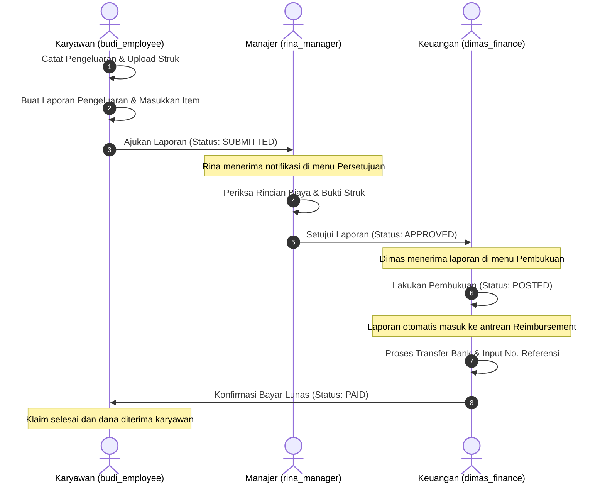

# Daftar Akun Pengguna, Password, dan Panduan Fitur Expenses

Dokumen ini berisi informasi lengkap mengenai akun demo (kredensial login), role, hak akses, serta penjelasan detail fitur yang dapat diakses oleh masing-masing username pada aplikasi **Expenses**.

---

## 1. Informasi Umum Kredensial & Autentikasi

- **Alamat URL Login Terintegrasi (Portal HRIS):** [`http://localhost/hris/`](http://localhost/hris/) (otomatis berbagi sesi SSO ke modul Expenses) atau langsung di [`http://localhost/hris/expenses/`](http://localhost/hris/expenses/).
- **Alamat URL Login Standalone:** [`http://127.0.0.1:8000/login`](http://127.0.0.1:8000/login) (jika dijalankan dengan `php -S 127.0.0.1:8000 -t public`).
- **Fleksibilitas Login:** Sistem menerima input berupa **Username** maupun **Email**.
- **Kata Sandi Global (Default):** `Password123!`
- **Keamanan Kata Sandi:** Semua kata sandi akun demo disimpan dalam bentuk hash aman menggunakan fungsi bawaan PHP `password_hash()` dengan algoritma BCRYPT. Tidak ada kata sandi yang disimpan dalam bentuk teks polos (*plaintext*).
- **Perlindungan Akun:** Dilengkapi pencatatan percobaan login (*login attempts*), pencegahan brute-force, regenerasi session ID saat login, dan token CSRF di setiap permintaan pengubahan data.

---

## 2. Tabel Ringkasan Akun Pengguna

| Username | Email Akun | Kata Sandi | Role Sistem | Nama Karyawan | Departemen / Posisi | Relasi Atasan / Tim |
|---|---|---|---|---|---|---|
| **`admin_gte`** | `admin@example.test` | `Password123!` | `ADMIN` | Admin Expenses | Divisi IT / System Administrator | Pengelola Master Data & Audit Global |
| **`rina_manager`** | `manager@example.test` | `Password123!` | `MANAGER` | Rina Manajer | Operasional / Engineering Manager | Atasan langsung dari Budi dan Sari |
| **`budi_employee`** | `budi@example.test` | `Password123!` | `EMPLOYEE` | Budi Santoso | Operasional / Senior Engineer | Bawahan langsung dari Rina Manajer |
| **`sari_employee`** | `sari@example.test` | `Password123!` | `EMPLOYEE` | Sari Putri | Operasional / Junior Analyst | Bawahan langsung dari Rina Manajer |
| **`dimas_finance`** | `finance@example.test` | `Password123!` | `FINANCE` | Dimas Finance | Keuangan & Pajak / Finance Officer | Pengelola Pembukuan & Reimbursement |

---

## 3. Penjelasan Fitur & Hak Akses Berdasarkan Username

### 3.1. Username: `admin_gte` (Role: ADMIN)
- **Identitas Login:** `admin_gte` atau `admin@example.test`
- **Password:** `Password123!`
- **Profil Pegawai:** Admin Expenses (`EMP-0105`), Divisi Teknologi Informasi (`DEPT-IT`)
- **Tanggung Jawab:** Pemeliharaan master data, administrasi pengguna, dan pengawasan audit sistem secara keseluruhan.

#### Fitur yang Dapat Diakses:
1. **Dashboard Khusus Admin (`/dashboard`):**
   - Menampilkan metrik agregat seluruh perusahaan: Jumlah Pengguna Aktif, Jumlah Kategori Pengeluaran Aktif, Total Catatan Pengeluaran Sistem, dan Total Akumulasi Biaya Terbayar (*Status PAID*).
2. **Manajemen Akun Pengguna (`/settings/users`):**
   - Mendaftarkan akun login baru dengan memilih username, email, kata sandi, peran (*role*), dan pemetaan data pegawai (*employee ID*).
   - Memperbarui data pengguna, mengubah email/role, dan melakukan reset kata sandi jika diperlukan.
   - Mengaktifkan atau menonaktifkan akun karyawan (*toggle is_active*) tanpa menghapus riwayat transaksi lama demi integritas data.
3. **Manajemen Kategori Pengeluaran (`/settings/categories`):**
   - Menambahkan kategori pengeluaran baru (misal: *Travel*, *Meal*, *Transport*, *Office Supplies*, *Other*).
   - Mengubah nama kategori, deskripsi, atau menonaktifkan kategori yang sudah tidak digunakan.
4. **Manajemen Departemen / Divisi (`/settings/departments`):**
   - Mengelola master departemen (kode departemen, nama divisi, dan deskripsi).
5. **Pemeriksaan Jejak Audit & Keamanan (`/settings/audit-logs`):**
   - Memantau log aktivitas dan mutasi data penting pada tabel `audit_logs` dan `activity_logs`.
   - Melihat rekam jejak waktu kejadian (*timestamp*), alamat IP pengguna, aksi yang dilakukan, serta data sebelum dan sesudah perubahan.
6. **Analisis & Ekspor Data (`/analytics`):**
   - Meninjau analitik grafik pengeluaran seluruh divisi perusahaan.
   - Mengunduh rekap data dalam format CSV aman (*dengan proteksi CSV formula injection*).

> [!NOTE]
> **Prinsip Pemisahan Tugas (Separation of Duties):**
> Sesuai arsitektur keamanan Expenses, akun `ADMIN` secara *default* **tidak** memiliki hak akses untuk menyetujui laporan (*expense.approve*) maupun mencairkan dana reimbursement (*expense.reimburse*). Keputusan operasional diserahkan kepada Manajer dan Finance masing-masing.

---

### 3.2. Username: `rina_manager` (Role: MANAGER)
- **Identitas Login:** `rina_manager` atau `manager@example.test`
- **Password:** `Password123!`
- **Profil Pegawai:** Rina Manajer (`EMP-0101`), Divisi Operasional (`DEPT-OPS`), Jabatan: Engineering Manager
- **Hierarki Organisasi:** Atasan langsung (*Direct Manager*) dari Budi Santoso (`EMP-0102`) dan Sari Putri (`EMP-0103`) berdasarkan kolom `employees.manager_id`.
- **Tanggung Jawab:** Memverifikasi kewajaran pengeluaran dinas bawahan langsung dan memberikan persetujuan atau penolakan.

#### Fitur yang Dapat Diakses:
1. **Dashboard Manajer (`/dashboard`):**
   - Menampilkan kartu metrik khusus: Jumlah Laporan Tim Menunggu Persetujuan (*Status SUBMITTED*), Total Nilai Rupiah yang Menunggu Keputusan, Total Laporan yang Disetujui Bulan Ini, dan Jumlah Anggota Tim Langsung.
2. **Antrean Persetujuan Tim (`/approvals`):**
   - Menampilkan daftar seluruh laporan pengeluaran yang diajukan hanya oleh bawahan langsungnya (Budi dan Sari).
   - **Isolasi Record (Strict Scope):** Manajer tidak dapat melihat atau menyetujui pengajuan dari divisi atau bawahan manajer lain.
3. **Pemeriksaan Detail & Bukti Struk Transaksi:**
   - Memeriksa rincian setiap item pengeluaran: tanggal transaksi, kategori, merchant/toko, nominal rupiah, dan deskripsi biaya.
   - Membuka dan mengunduh berkas kuitansi/bukti pembayaran (*receipt*) secara aman melalui sistem otorisasi privat.
4. **Eksekusi Keputusan Persetujuan (*Approve / Refuse*):**
   - **Setujui Laporan (Approve):** Mengubah status laporan menjadi `APPROVED`, mencatat riwayat persetujuan di tabel `expense_approvals`, dan meneruskan laporan ke bagian Finance.
   - **Tolak Laporan (Refuse):** Menolak laporan dengan **wajib mengisi alasan penolakan** (*Rejection Reason*). Status berubah menjadi `REFUSED` sehingga karyawan dapat melakukan perbaikan.
5. **Pemantauan Pengeluaran & Laporan Tim (`/expenses` & `/reports`):**
   - Rina dapat melihat dan memantau daftar pengeluaran serta laporan pengeluaran seluruh anggota tim bawahannya.
   - Sesuai tata kelola persetujuan, peran Manajer **tidak memiliki akses/fitur untuk menambah pengeluaran baru maupun membuat laporan klaim** demi menjaga integritas pemisahan tugas (*segregation of duties*).
6. **Analisis Tim (`/analytics`):**
   - Melihat grafik tren pengeluaran dan distribusi kategori biaya khusus anggota tim operasional yang dipimpinnya.

---

### 3.3. Username: `budi_employee` (Role: EMPLOYEE)
- **Identitas Login:** `budi_employee` atau `budi@example.test`
- **Password:** `Password123!`
- **Profil Pegawai:** Budi Santoso (`EMP-0102`), Divisi Operasional (`DEPT-OPS`), Jabatan: Senior Engineer
- **Atasan Langsung:** Rina Manajer
- **Data Rekening:** Bank BCA (No. Rek: `2345678901`)
- **Tanggung Jawab:** Melakukan pencatatan pengeluaran dinas pribadi, mengunggah bukti transaksi, dan mengajukan laporan klaim ke manajer.

#### Fitur yang Dapat Diakses:
1. **Dashboard Karyawan (`/dashboard`):**
   - Memantau jumlah pengeluaran berstatus *DRAFT*, laporan yang sedang menunggu persetujuan atasan (*Status SUBMITTED*), laporan yang disetujui/sedang diproses, serta total akumulasi dana reimbursement yang sudah berhasil dicairkan (*Status PAID*).
2. **Pencatatan Pengeluaran Pribadi (`/expenses`):**
   - Membuat catatan pengeluaran baru (*Create Expense*): mengisi tanggal pengeluaran, kategori (Travel, Makan, Transport, dsb.), nominal uang rupiah, metode pembayaran, **pilihan bank transaksi/rekening tujuan (BCA, Mandiri, BNI, BRI, BSI, CIMB, Permata, dsb. dengan rekomendasi otomatis sesuai bank terdaftar pegawai)**, keterangan keperluan, merchant/vendor, dan catatan.
   - Mengunggah berkas bukti transaksi / struk (*Receipt Upload*): format JPG, PNG, atau PDF (maksimal 5MB).
   - Melihat, mengubah, atau menghapus pengeluaran serta pilihan bank selama statusnya masih `DRAFT`.
   - Mengganti atau menghapus berkas struk yang salah saat status masih `DRAFT`.
3. **Pengelolaan Laporan Pengeluaran (*Expense Reports*) (`/reports`):**
   - Membuat laporan pengeluaran baru (*Create Report*) untuk mengelompokkan beberapa bukti pengeluaran dinas dalam satu judul berkas klaim.
   - Menambahkan atau mencopot item pengeluaran berstatus *DRAFT* ke dalam laporan. Total nominal laporan dihitung secara otomatis dan akurat oleh database.
   - **Mengajukan Laporan (Submit):** Mengunci laporan dan mengubah status menjadi `SUBMITTED` agar masuk ke antrean persetujuan Manager Rina.
   - **Revisi Laporan (Revise):** Jika laporan ditolak oleh manajer, Budi dapat membaca catatan penolakan dari manajer, memperbaiki item pengeluaran, lalu mengajukannya kembali.
   - Berinteraksi melalui timeline komentar laporan (`expense_comments`).
4. **Data Demo yang Siap Diuji Milik Budi:**
   - `EXP-DEMO-001`: Makan siang koordinasi tim (Rp 150.000, Status: DRAFT).
   - `EXP-DEMO-002`: Taksi Bluebird ke klien (Rp 85.000, Status: DRAFT).
   - `GTE-DEMO-001`: Laporan Draft (*Biaya Transport & Jamuan Budi*).
   - `GTE-DEMO-003`: Laporan Disetujui (*Pengadaan Kebutuhan Workshop Internal*, Status: APPROVED, siap dibukukan oleh Finance).
   - `GTE-DEMO-005`: Laporan Selesai Dibayar (*Operasional Transport Budi Bulan Lalu*, Status: PAID).

> [!IMPORTANT]
> **Privasi Data Pegawai:**
> Budi **tidak dapat** melihat, mengedit, mengunduh struk, atau mengakses data pengeluaran milik karyawan lain (seperti milik Sari Putri). Sistem menerapkan *record-level ownership verification* secara ketat di sisi server.

---

### 3.4. Username: `sari_employee` (Role: EMPLOYEE)
- **Identitas Login:** `sari_employee` atau `sari@example.test`
- **Password:** `Password123!`
- **Profil Pegawai:** Sari Putri (`EMP-0103`), Divisi Operasional (`DEPT-OPS`), Jabatan: Junior Analyst
- **Atasan Langsung:** Rina Manajer
- **Data Rekening:** Bank Mandiri (No. Rek: `3456789012`)
- **Tanggung Jawab:** Karyawan operasional untuk pengujian skenario alur laporan *Submitted* dan laporan yang ditolak (*Refused*).

#### Fitur yang Dapat Diakses:
1. **Dashboard & Manajemen Pengeluaran Pribadi (`/expenses` & `/reports`):**
   - Fitur identik dengan peran karyawan: catat pengeluaran baru, upload kuitansi, buat dan ajukan laporan klaim pribadi.
2. **Skenario Pengujian Khusus yang Siap Diuji Milik Sari:**
   - **Laporan Sedang Diajukan (`SUBMITTED`):**
     - Kode Laporan: `GTE-DEMO-002` (*Kunjungan Lapangan Sari ke Bandung*, Total: Rp 625.000).
     - Berisi pengeluaran tiket kereta (`EXP-DEMO-003`) dan makan malam dinas (`EXP-DEMO-004`).
     - *Tujuan Uji:* Membuktikan bahwa laporan dan item berstatus `SUBMITTED` terkunci (tidak dapat diedit atau dihapus sembarangan oleh karyawan selama proses persetujuan).
   - **Laporan Ditolak Manajer (`REFUSED`):**
     - Kode Laporan: `GTE-DEMO-004` (*Cinderamata Klien Sari (Ditolak)*, Total: Rp 600.000).
     - Berisi pengeluaran `EXP-DEMO-006` dengan alasan penolakan: *"Kuitansi belum resmi dari toko/merchant. Mohon lampirkan faktur atau nota resmi."*
     - *Tujuan Uji:* Membuktikan alur revisi laporan oleh karyawan, di mana Sari dapat membaca alasan penolakan, mengklik tombol **Revisi Laporan**, dan memperbarui dokumen pendukung.

---

### 3.5. Username: `dimas_finance` (Role: FINANCE)
- **Identitas Login:** `dimas_finance` atau `finance@example.test`
- **Password:** `Password123!`
- **Profil Pegawai:** Dimas Finance (`EMP-0104`), Divisi Keuangan & Pajak (`DEPT-FIN`), Jabatan: Finance Officer
- **Tanggung Jawab:** Memverifikasi laporan yang telah disetujui manajer, melakukan pembukuan (*posting*), dan mengeksekusi pencairan reimbursement ke rekening pegawai.

#### Fitur yang Dapat Diakses:
1. **Dashboard Keuangan (`/dashboard`):**
   - Menampilkan metrik operasional keuangan: Jumlah Laporan Menunggu Pembukuan (*Awaiting Posting*), Jumlah Antrean Siap Bayar (*Awaiting Reimbursement*), dan Total Nilai Reimbursement yang Telah Dibayarkan Bulan Ini.
2. **Antrean Pembukuan Laporan / Posting (`/finance/posting`):**
   - Melihat seluruh laporan pengeluaran berstatus `APPROVED` dari seluruh departemen perusahaan.
   - Memverifikasi kepatuhan nilai nominal, rincian biaya, serta berkas kuitansi pendukung.
   - **Eksekusi Pembukuan (Post Report):** Mengubah status laporan menjadi `POSTED`. Sistem secara otomatis dan transaksional mendaftarkan laporan tersebut ke antrean pencairan reimbursement dengan status `PENDING`.
3. **Manajemen Pencairan Dana Reimbursement (`/reimbursements`):**
   - **Daftar Antrean Pembayaran:** Melihat daftar klaim yang siap dibayarkan kepada karyawan lengkap dengan nomor rekening bank tujuan (BCA, Mandiri, BNI, dsb.).
   - **Ubah ke Status Proses (Set Processing):** Menandai bahwa bagian kasir sedang menyiapkan pembayaran transfer bank (*Status PROCESSING*).
   - **Konfirmasi Pembayaran Selesai (Mark Paid):**
     - Memilih metode transfer pembayaran (*Bank Transfer*, Kas, dsb.).
     - Menginput **Nomor Referensi Pembayaran / Bukti Transfer** (misal: `TRF-BCA-20261014-001`).
     - Menginput tanggal transfer riil.
     - Sistem secara atomik mengupdate status reimbursement menjadi `PAID`, serta memperbarui status laporan (`expense_reports`) dan seluruh item pengeluaran (`expenses`) di dalamnya menjadi `PAID`.
   - **Tandai Pembayaran Gagal (Mark Failed):** Jika terjadi kendala nomor rekening tidak valid atau retur bank.
4. **Riwayat Pembayaran Reimbursement (`/reimbursements/history`):**
   - Menampilkan rekapan seluruh pencairan dana yang telah selesai diproses untuk keperluan audit pembukuan.
5. **Analisis Keuangan & Ekspor CSV Global (`/analytics`):**
   - Memantau grafik arus pengeluaran perusahaan secara menyeluruh.
   - Mengekspor data riwayat transaksi dan data laporan ke file CSV untuk kebutuhan rekonsiliasi akuntansi.

---

## 4. Matriks Perbandingan Hak Akses Fitur (Feature Matrix)

| Fitur / Menu Navigasi | EMPLOYEE (`budi_employee`, `sari_employee`) | MANAGER (`rina_manager`) | FINANCE (`dimas_finance`) | ADMIN (`admin_gte`) |
|---|:---:|:---:|:---:|:---:|
| **Dashboard Metrik** | Milik Pribadi | Tim Bawahan | Alur Keuangan | Global Sistem |
| **Catat & Kelola Expense Sendiri** | ✅ Ya (DRAFT) | ❌ Tidak (Khusus Review Tim) | ✅ Ya (DRAFT) | ✅ Ya (DRAFT) |
| **Upload Bukti Kuitansi (Privat)** | ✅ Ya | ❌ Tidak | ✅ Ya | ✅ Ya |
| **Buat & Ajukan Laporan Sendiri** | ✅ Ya | ❌ Tidak (Khusus Review Tim) | ✅ Ya | ✅ Ya |
| **Persetujuan Tim Bawahan (`/approvals`)** | ❌ Tidak | ✅ Ya (Direct Reports) | ❌ Tidak | ❌ Tidak (Default) |
| **Tolak Laporan dengan Alasan** | ❌ Tidak | ✅ Ya (Wajib Alasan) | ❌ Tidak | ❌ Tidak |
| **Pembukuan Laporan / Posting (`/finance/posting`)** | ❌ Tidak | ❌ Tidak | ✅ Ya (`expense.post`) | ❌ Tidak |
| **Pencairan Dana Reimbursement (`/reimbursements`)** | ❌ Tidak | ❌ Tidak | ✅ Ya (`expense.reimburse`) | ❌ Tidak |
| **Pencatatan No. Referensi Transfer Bank** | ❌ Tidak | ❌ Tidak | ✅ Ya | ❌ Tidak |
| **Manajemen Akun Pengguna (`/settings/users`)** | ❌ Tidak | ❌ Tidak | ❌ Tidak | ✅ Ya (`users.manage`) |
| **Manajemen Master Kategori (`/settings/categories`)** | ❌ Tidak | ❌ Tidak | ❌ Tidak | ✅ Ya (`settings.manage`) |
| **Manajemen Departemen (`/settings/departments`)** | ❌ Tidak | ❌ Tidak | ❌ Tidak | ✅ Ya (`settings.manage`) |
| **Log Audit Keamanan (`/settings/audit-logs`)** | ❌ Tidak | ❌ Tidak | ❌ Tidak | ✅ Ya |
| **Ekspor Laporan CSV** | Data Pribadi | Data Tim | Data Keuangan Global | Data Global Sistem |

---

## 5. Alur Kerja Pengujian End-to-End (Simulasi Siklus Klaim)

Anda dapat menguji siklus lengkap pengelolaan pengeluaran dari awal hingga cair dengan berpindah antar-akun:



### Langkah Pengujian Praktis:
1. **Langkah 1 (Karyawan):**
   - Login sebagai `budi_employee` (password: `Password123!`).
   - Masuk ke menu **Pengeluaran** -> Klik **+ Catat Pengeluaran Baru**.
   - Masuk ke menu **Laporan Saya** -> Klik **+ Buat Laporan Baru**, tambahkan item pengeluaran tadi, lalu klik **Ajukan Laporan (Submit)**.
   - Keluar (*Logout*).
2. **Langkah 2 (Manajer):**
   - Login sebagai `rina_manager` (password: `Password123!`).
   - Masuk ke menu **Persetujuan Tim** (`/approvals`). Laporan Budi akan muncul di daftar.
   - Klik laporan untuk melihat rincian pengeluaran dan berkas struk, lalu klik **Setujui Laporan (Approve)**.
   - Keluar (*Logout*).
3. **Langkah 3 (Finance):**
   - Login sebagai `dimas_finance` (password: `Password123!`).
   - Masuk ke menu **Pembukuan (Posting)** (`/finance/posting`), lalu klik **Bukukan Laporan (Post)**.
   - Masuk ke menu **Reimbursement** (`/reimbursements`), klik **Bayar / Proses Pembayaran**, masukkan nomor referensi transfer (contoh: `TRF-BCA-100293`), lalu klik **Konfirmasi Pembayaran**.
   - Status laporan dan reimbursement kini telah resmi berstatus `PAID` (Selesai).

---

## 6. Cara Menginisialisasi Akun Demo jika Belum Ada di Database

Jika database Anda baru saja diimpor dari skema baseline dan akun demo di atas belum terpasang, cukup jalankan perintah PHP CLI berikut di terminal proyek:

```powershell
php bin/seed_demo.php
```

Perintah di atas bersifat **idempoten** (aman dijalankan berulang kali tanpa menduplikasi data atau merusak data yang telah ada). Script akan secara otomatis menghasilkan seluruh 5 akun di atas dengan password hash terstandarisasi `Password123!`.

---

## 7. Tautan Dokumen Terkait

- [Panduan Cara Menjalankan Expenses](CARA_MENJALANKAN.md)
- [Spesifikasi Teknis Modul Expenses](README.md)
- [README Utama HRIS & ERP](../README.md)
